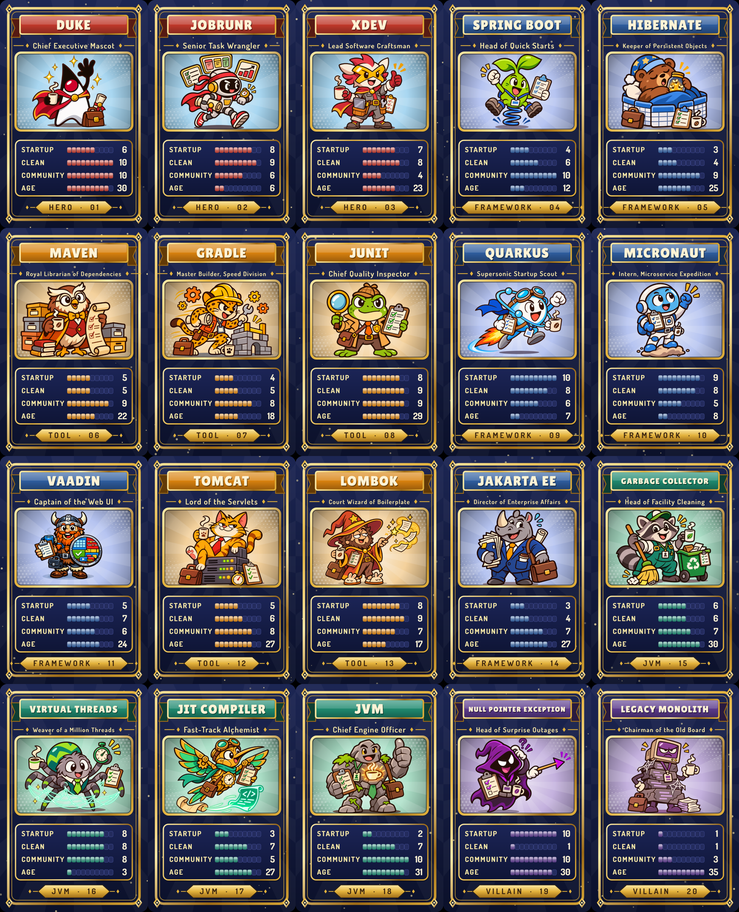

# Java-Dex

A small Top Trumps style card game with 20 original cards about the Java world: Duke, frameworks, build tools, parts of the JVM and a few villains. Every card has a job title, three made-up stats and one real number, the age of the project.

The cards were made for a live-coding session about training an image classifier with Java, Spring AI and JobRunr. Hold a card in front of a webcam, the classifier names it, and the game plays the round. The classifier app will be added to this repository.

## How to play

Two players, 10 cards each, face down. Read the full rules in [docs/RULES.md](docs/RULES.md).

1. The starting player looks at their top card and picks one of four stats: Startup, Clean, Community or Age.
2. Both players reveal their top card. The higher number wins both cards.
3. On a tie, both cards go to the bottom of their piles.
4. The winner picks the next stat. Whoever holds all cards, or the most after 10 rounds, wins.

## The cards

| # | Card | Type | Job title | Startup | Clean | Community | Age |
|---|---|---|---|---|---|---|---|
| 1 | [Duke](cards/png/jd01.png) | Hero | Chief Executive Mascot | 6 | 10 | 10 | 30 |
| 2 | [JobRunr](cards/png/jd02.png) | Hero | Senior Task Wrangler | 8 | 9 | 6 | 6 |
| 3 | [XDEV](cards/png/jd03.png) | Hero | Lead Software Craftsman | 7 | 8 | 4 | 23 |
| 4 | [Spring Boot](cards/png/jd04.png) | Framework | Head of Quick Starts | 4 | 6 | 10 | 12 |
| 5 | [Hibernate](cards/png/jd05.png) | Framework | Keeper of Persistent Objects | 3 | 4 | 9 | 25 |
| 6 | [Maven](cards/png/jd06.png) | Tool | Royal Librarian of Dependencies | 5 | 5 | 9 | 22 |
| 7 | [Gradle](cards/png/jd07.png) | Tool | Master Builder, Speed Division | 4 | 5 | 8 | 18 |
| 8 | [JUnit](cards/png/jd08.png) | Tool | Chief Quality Inspector | 8 | 9 | 9 | 29 |
| 9 | [Quarkus](cards/png/jd09.png) | Framework | Supersonic Startup Scout | 10 | 8 | 6 | 7 |
| 10 | [Micronaut](cards/png/jd10.png) | Framework | Intern, Microservice Expedition | 9 | 8 | 5 | 8 |
| 11 | [Vaadin](cards/png/jd11.png) | Framework | Captain of the Web UI | 5 | 7 | 6 | 24 |
| 12 | [Tomcat](cards/png/jd12.png) | Tool | Lord of the Servlets | 5 | 6 | 8 | 27 |
| 13 | [Lombok](cards/png/jd13.png) | Tool | Court Wizard of Boilerplate | 8 | 9 | 7 | 17 |
| 14 | [Jakarta EE](cards/png/jd14.png) | Framework | Director of Enterprise Affairs | 3 | 4 | 7 | 27 |
| 15 | [Garbage Collector](cards/png/jd15.png) | JVM | Head of Facility Cleaning | 6 | 6 | 7 | 30 |
| 16 | [Virtual Threads](cards/png/jd16.png) | JVM | Weaver of a Million Threads | 8 | 8 | 8 | 3 |
| 17 | [JIT Compiler](cards/png/jd17.png) | JVM | Fast-Track Alchemist | 3 | 7 | 5 | 27 |
| 18 | [JVM](cards/png/jd18.png) | JVM | Chief Engine Officer | 2 | 7 | 10 | 31 |
| 19 | [NullPointerException](cards/png/jd19.png) | Villain | Head of Surprise Outages | 10 | 1 | 10 | 30 |
| 20 | [Legacy Monolith](cards/png/jd20.png) | Villain | Chairman of the Old Board | 1 | 1 | 3 | 35 |

Startup, Clean and Community are made up for game balance, each from 1 to 10. Age is the real age of the project in years (first release, rounded) for every card except the Legacy Monolith, which is fictional.

## Files

| Path | What it is |
|---|---|
| `cards/cards.json` | All card data: id, number, type, title, job title, stats |
| `cards/svg/jdNN.svg` | The card fronts as vector files |
| `cards/png/jdNN.png` | The card fronts as 300 dpi pictures, 59 x 91 mm |
| `cards/svg/back.svg`, `cards/png/back.png` | The back, the same on every card |
| `docs/RULES.md` | The rules |

## License

CC BY 4.0, see [LICENSE](LICENSE). Credits, the note on AI generated art and the trademark note are in [NOTICE](NOTICE). Made by Johannes Rabauer for the Java Usergroup Oberpfalz.
